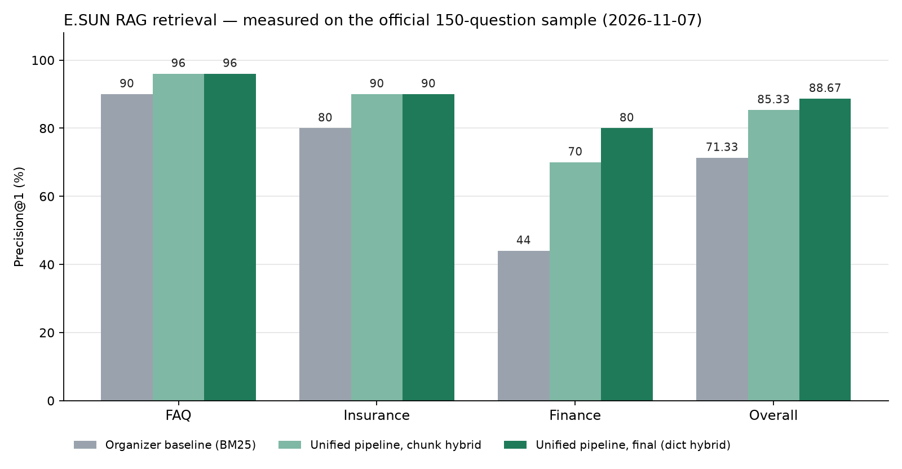
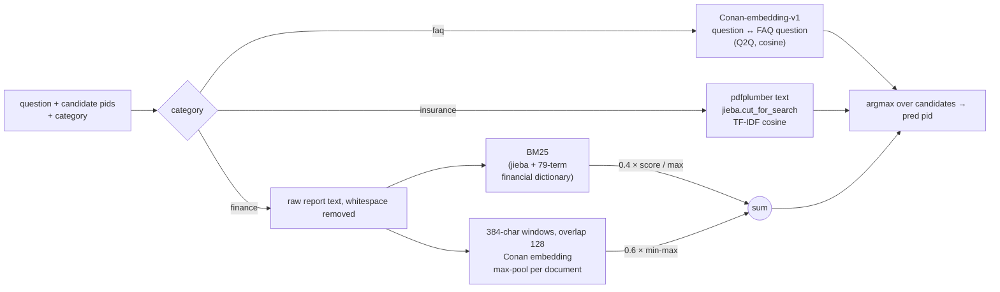

# E.SUN Bank AI Challenge — Financial Q&A Document Retrieval

[繁體中文版 README](README.zh-TW.md)

A retrieval system that, given a short colloquial question and a list of candidate documents, picks
the one document that answers it — across three very different sources: bank FAQ entries (JSON),
insurance policy terms (PDF) and listed-company financial reports (PDF). Built for the E.SUN Bank AI
competition (preliminary round, retrieval task) as a course project for *Introduction to Financial
Technology* at National Taiwan University.

## Results

Evaluated on the organizer's public example set: **150 questions (50 FAQ / 50 insurance / 50 finance),
metric Precision@1** (the top-ranked candidate must be the correct document). Every number below was
obtained by actually re-running code on 2026-11-07; nothing is copied from older reports.

| Method | FAQ | Insurance | Finance | **Overall** |
| :--- | :---: | :---: | :---: | :---: |
| Organizer baseline (jieba + BM25) | 90% | 80% | 44% | **71.33%** (107/150) |
| Team's integrated version, 2024-11-09 (TF-IDF) | 92% | 90% | 58% | 80.00% (120/150) |
| `best_retrievers` collection (Conan embeddings per category) | 96% | 88% | 66% | 83.33% (125/150) |
| `scripts/standalone_rag_pipeline.py` | 96% | 86% | 62% | 81.33% (122/150) |
| `scripts/unified_pipeline.py --finance_method chunk_hybrid` | 96% | 90% | 70% | 85.33% (128/150) |
| **`scripts/unified_pipeline.py` (default `dict_hybrid`)** | **96%** | **90%** | **80%** | **88.67% (133/150)** |

**Headline: 88.67% P@1 from a single script in a single run, +17.3 points over the organizer
baseline.** Please read [Limitations](#limitations-and-honest-notes): the methods were selected on
these same 150 questions.



## Method



All three retrievers only rank the candidate documents listed in each question's `source` field.

**FAQ — question-to-question matching (96%).** Users ask short, colloquial questions while FAQ answers
are long and formal. Instead of comparing the question with the answer, each user question is embedded
with [Conan-embedding-v1](https://huggingface.co/TencentBAC/Conan-embedding-v1) (CLS pooling, L2
normalised) and compared with the *questions* stored in the FAQ entries. This turns an asymmetric
problem into a symmetric one and lifts FAQ from 90% (BM25) to 96%.

**Insurance — TF-IDF over policy text (90%).** Text is extracted with pdfplumber, segmented with
`jieba.cut_for_search`, and candidates are ranked by TF-IDF cosine similarity (from the team's
2024-11-09 version). An earlier article-level chunking + embedding approach reached 88%.

**Finance — raw-text chunk hybrid (80%).** Financial reports are long, table-heavy and nearly
identical in wording across companies and quarters, so this was the hardest category (baseline 44%).
The final method:

1. uses the *raw* extracted report text (all whitespace, page numbers, `$` and FSC filing numbers
   removed) rather than the earlier pre-segmented text, which had stripped words such as 年/月
   (year/month);
2. scores each candidate with BM25 over jieba tokens, where jieba is given a 79-term financial
   dictionary from the team's 2024-11-08 `financial_dictionary.py` (statement names and line items);
3. splits each report into 384-character windows with 128-character overlap, embeds them with
   Conan-embedding-v1, and takes the maximum similarity to the question;
4. combines them as `0.4 × BM25/max(BM25) + 0.6 × minmax(dense)` — the 0.4/0.6 weights were reused
   from the team's earlier scripts, not tuned here.

What actually mattered (finance, 50 questions; details in [docs/ablation_study.md](docs/ablation_study.md), in Chinese):

| Change | Finance P@1 |
| :--- | :---: |
| Chunked embeddings on the old pre-segmented text | 46% |
| Chunked embeddings on raw text | 76% |
| + BM25 hybrid, no dictionary | 78% |
| + financial dictionary (final `dict_hybrid`) | 80% |
| Same, but truncated (first 512 tokens) instead of chunked | 72% |
| Same, plus the 2024-11-08 date normaliser | 74% |

The text version and the hybrid fusion account for almost all of the gain; the dictionary adds one
question.

## How the project evolved

Built in November 2024 as a team project; the standalone script was added in August 2026, and the
re-run, the unified pipeline and this cleanup were done in November 2026. All numbers are measured
(re-run on 2026-11-07) on the 150 example questions.

| Date | Version and idea | Measured (FAQ / insurance / finance → overall) |
| :--- | :--- | :--- |
| — | Organizer baseline: jieba + BM25 | 90 / 80 / 44 → **71.33%** |
| 2024-11-02 | Conan embeddings, whole document vs. question (finance) | finance 66% |
| 2024-11-05 | FAQ question-to-question (Q2Q) matching | FAQ **96%** |
| 2024-11-06 | Insurance article-level chunking + embeddings; OCR and table extraction | insurance **88%** |
| 2024-11-08 | Financial dictionary + date normaliser (BM25 only) | finance 52% |
| 2024-11-09 | Integrated TF-IDF version | 92 / 90 / 58 → **80.00%** |
| 2024-11-09 | TF-IDF + pdfplumber table extraction | finance **68%** (overall 54.67%: no Q2Q for FAQ) |
| after 2024-11-09 | `best_retrievers` collection | 96 / 88 / 66 → **83.33%** |
| 2026-08 | `standalone_rag_pipeline.py` | 96 / 86 / 62 → **81.33%** |
| 2026-11-07 | `unified_pipeline.py`, finance `chunk_hybrid` | 96 / 90 / 70 → **85.33%** |
| 2026-11-07 | `unified_pipeline.py`, finance `dict_hybrid` | 96 / 90 / 80 → **88.67%** |

Not re-run: the 2024-11-01 refactor and the 2024-11-09 DSSM model (both need `bert-base-chinese`,
which is not part of this setup).

## How to reproduce

**1. Environment** (Python ≥ 3.10; a CPU is enough — the full run takes about 10 minutes on a
10-core Apple M4 laptop):

```bash
python3 -m venv .venv && source .venv/bin/activate
pip install -r requirements.txt
```

**2. Data.** The competition data was provided by the organizer (E.SUN Bank) to participants and is
not redistributable, so it is not in this repository. Put the official preliminary-round files under
`data/` exactly as described in [data/README.md](data/README.md):

```text
data/
├── dataset/preliminary/questions_example.json
├── dataset/preliminary/ground_truths_example.json
└── reference/{faq/pid_map_content.json, finance/*.pdf, insurance/*.pdf}
```

**3. Model.** [`TencentBAC/Conan-embedding-v1`](https://huggingface.co/TencentBAC/Conan-embedding-v1)
is downloaded from Hugging Face automatically on first use. If you already have a local copy, pass its
directory with `--model`; only the BERT weights and tokenizer are used (CLS pooling), the
sentence-transformers Pooling/Dense layers are not needed.

**4. Run.**

```bash
# Build the raw finance text (948 of 1,035 PDFs have a text layer; ~20 s)
python scripts/build_finance_raw.py --source_path data/reference

# Retrieve all 150 questions and score them (~10 min on CPU)
python scripts/unified_pipeline.py \
    --question_path data/dataset/preliminary/questions_example.json \
    --source_path   data/reference \
    --output_path   data/processed/pred_retrieve.json \
    --gt_path       data/dataset/preliminary/ground_truths_example.json
#   [--model /path/to/Conan-embedding-v1]
```

Expected output:

```text
insurance : 45/50 = 90.00%
finance   : 40/50 = 80.00%
faq       : 48/50 = 96.00%
overall   : 133/150 = 88.67%
```

Any prediction file in the submission format can be scored with
`python scripts/evaluate.py --pred_path <pred.json> --gt_path data/dataset/preliminary/ground_truths_example.json`.

**Other variants** need the older pre-segmented corpus, rebuilt with
`python scripts/build_processed_corpus.py --source_path data/reference` (port of the team's
2024-11-06 preprocessing; insurance output matches the archived file exactly, 54 of 948 finance
documents differ slightly because of PDF-library versions):

- `unified_pipeline.py --finance_method chunk_hybrid` (85.33%) or `--finance_method tfidf` (84.67%)
- `standalone_rag_pipeline.py --mode eval` (81.33%)
- finance exploration scripts `test_improved_finance.py`, `compare_all_algorithms.py`,
  `test_fast_finance_inference.py`, `build_finance_embeddings.py`; these read
  `data/benchmark_experiment/{questions,ground_truths}.json` (copies of the two example files) and
  `compare_all_algorithms.py` / `test_fast_finance_inference.py` also need the embedding file written
  by `build_finance_embeddings.py`.

## Repository structure

```text
.
├── README.md / README.zh-TW.md
├── requirements.txt
├── scripts/
│   ├── unified_pipeline.py          # main pipeline (88.67%)
│   ├── build_finance_raw.py         # official finance PDFs -> data/processed/finance_content.json
│   ├── evaluate.py                  # Precision@1 scorer for any prediction file
│   ├── build_processed_corpus.py    # older pre-segmented corpus (alternative variants only)
│   ├── standalone_rag_pipeline.py   # earlier single-file version (81.33%)
│   └── test_improved_finance.py, compare_all_algorithms.py,
│       test_fast_finance_inference.py, build_finance_embeddings.py   # finance experiments
├── docs/
│   ├── ablation_study.md            # what helped and what did not (measured)
│   ├── results.png                  # results chart
│   └── make_results_chart.py        # script that draws it
├── data/README.md                   # where to put the (non-public) competition data
```

## Limitations and honest notes

- **Selection bias.** There is no held-out set: the finance method was chosen after comparing more than
  ten variants on the same 50 finance questions it is scored on, so 88.67% is optimistic. The
  0.4/0.6 weights were reused rather than tuned (a sweep shows 80–82% for BM25 weights 0.1–0.4), but
  the choice of method itself is still selected on the test data.
- **The financial dictionary is a minor factor** (+1 question). The gain comes from using raw text and
  the chunked hybrid.
- **The unified pipeline is a 2026 reconstruction**, assembled from the team's 2024 components; it is
  not the entry submitted during the competition, and the official leaderboard score is not recorded
  here.
- **Scanned PDFs are skipped.** 87 finance PDFs have no text layer; the pipeline does not run OCR on them.

## Team and my contribution

Team project for *Introduction to Financial Technology* (NTU).

Three-person team. My parts: testing the retrieval accuracy of the candidate embedding models, and the finance reranking stage, which re-scores candidate report chunks by fusing embedding and BM25 scores (the finance hybrid described above).
