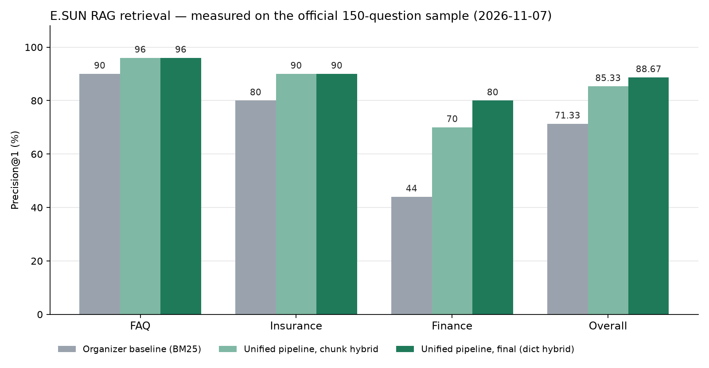
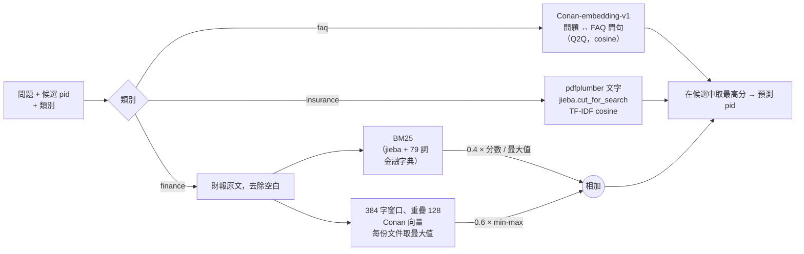

# 玉山銀行 AI 挑戰賽：金融問答文件檢索

[English README](README.md)

給一個簡短、口語化的問題和一份候選文件清單，系統要從中挑出能回答問題的那一份。資料來源有三種，型態差很多：銀行 FAQ（JSON）、保險條款（PDF）、上市公司財務報告（PDF）。本專案是台大「金融科技導論」的課程專題，參加玉山銀行 AI 競賽（初賽，檢索題）。

## 結果

評估集是主辦方公開的範例題：**150 題（FAQ／保險／金融各 50 題），指標為 Precision@1**（排第一的候選必須是正確文件）。下表每個數字都是 2026-11-07 實際重新執行程式得到的，沒有抄自舊報告。

| 方法 | FAQ | 保險 | 金融 | **整體** |
| :--- | :---: | :---: | :---: | :---: |
| 主辦方 baseline（jieba + BM25） | 90% | 80% | 44% | **71.33%**（107/150） |
| 團隊 2024-11-09 整合版（TF-IDF） | 92% | 90% | 58% | 80.00%（120/150） |
| `best_retrievers` 整合包（各類別用 Conan 向量） | 96% | 88% | 66% | 83.33%（125/150） |
| `scripts/standalone_rag_pipeline.py` | 96% | 86% | 62% | 81.33%（122/150） |
| `scripts/unified_pipeline.py --finance_method chunk_hybrid` | 96% | 90% | 70% | 85.33%（128/150） |
| **`scripts/unified_pipeline.py`（預設 `dict_hybrid`）** | **96%** | **90%** | **80%** | **88.67%（133/150）** |

**主數字：單一程式、一次執行 88.67% P@1，比主辦方 baseline 高 17.3 個百分點。** 請一併閱讀[限制與誠實說明](#限制與誠實說明)：方法是在同一份 150 題上挑選的。



## 方法



三種檢索都只在每題 `source` 欄位列出的候選文件中排序。

**FAQ：問對問（Q2Q），96%。** 使用者的問題短而口語，FAQ 答案長而正式。我們不拿問題去比對答案，而是用 [Conan-embedding-v1](https://huggingface.co/TencentBAC/Conan-embedding-v1)（CLS pooling、L2 正規化）把使用者問題和 FAQ 裡的「問句」做比對，把非對稱檢索變成對稱檢索。FAQ 從 BM25 的 90% 提升到 96%。

**保險：條款文字 TF-IDF，90%。** 用 pdfplumber 抽文字、`jieba.cut_for_search` 斷詞，以 TF-IDF cosine 排序（來自團隊 2024-11-09 版本）。較早的「條款切片 + 向量」做法為 88%。

**金融：原文切片 hybrid，80%。** 財報又長、表格又多，而且不同公司、不同季度的用字幾乎一樣，是最難的類別（baseline 44%）。最終做法：

1. 使用 PDF 抽出的**原文**（去掉所有空白、頁碼、`$` 和金管會字號），不用舊的已斷詞文字（舊文字把「年／月」等字都刪掉了）；
2. 用 BM25 對 jieba 斷詞結果打分，jieba 加入團隊 2024-11-08 `financial_dictionary.py` 的 79 個金融詞（報表名稱與會計科目）；
3. 把每份財報切成 384 字、重疊 128 字的窗口，用 Conan-embedding-v1 編碼，取與問題最相似的窗口分數；
4. 以 `0.4 × BM25/max(BM25) + 0.6 × minmax(向量)` 融合。0.4/0.6 沿用團隊既有腳本，沒有在這裡調參。

真正有影響的因素（金融 50 題，詳見 [docs/ablation_study.md](docs/ablation_study.md)）：

| 變化 | 金融 P@1 |
| :--- | :---: |
| 舊的已斷詞文字做切片向量 | 46% |
| 原文做切片向量 | 76% |
| ＋ BM25 hybrid（不加字典） | 78% |
| ＋ 金融字典（最終 `dict_hybrid`） | 80% |
| 同上，但用截斷（前 512 token）取代切片 | 72% |
| 同上，再加 2024-11-08 時間正規化 | 74% |

提升幾乎都來自「改用原文」和「hybrid 融合」；字典只多答對 1 題。

## 實驗演進

2024 年 11 月為團隊專題開發；standalone 腳本於 2026 年 8 月加入；重跑、單一 pipeline 與整理在 2026 年 11 月完成。以下數字全部是 2026-11-07 在 150 題範例上實際重跑的結果。

| 日期 | 版本與想法 | 實測（FAQ／保險／金融 → 整體） |
| :--- | :--- | :--- |
| — | 主辦方 baseline：jieba + BM25 | 90／80／44 → **71.33%** |
| 2024-11-02 | Conan 向量，整份文件對問題（金融） | 金融 66% |
| 2024-11-05 | FAQ 問句對問句（Q2Q） | FAQ **96%** |
| 2024-11-06 | 保險條款切片 + 向量；OCR 與表格抽取 | 保險 **88%** |
| 2024-11-08 | 金融字典 + 時間處理器（只用 BM25） | 金融 52% |
| 2024-11-09 | 整合版 TF-IDF | 92／90／58 → **80.00%** |
| 2024-11-09 | TF-IDF + pdfplumber 表格抽取 | 金融 **68%**（整體 54.67%：FAQ 沒有 Q2Q） |
| 2024-11-09 之後 | `best_retrievers` 整合包 | 96／88／66 → **83.33%** |
| 2026-08 | `standalone_rag_pipeline.py` | 96／86／62 → **81.33%** |
| 2026-11-07 | `unified_pipeline.py`，金融 `chunk_hybrid` | 96／90／70 → **85.33%** |
| 2026-11-07 | `unified_pipeline.py`，金融 `dict_hybrid` | 96／90／80 → **88.67%** |

沒有重跑：2024-11-01 重構版與 2024-11-09 DSSM（都需要 `bert-base-chinese`，不在本專案環境內）。

## 如何重現

**1. 環境**（Python ≥ 3.10；CPU 即可，完整執行在 10 核 Apple M4 筆電約 10 分鐘）：

```bash
python3 -m venv .venv && source .venv/bin/activate
pip install -r requirements.txt
```

**2. 資料。** 比賽資料由競賽主辦方（玉山銀行）提供給參賽者，不可再散布，所以不在本 repo 內。請依 [data/README.md](data/README.md) 把官方初賽檔案放到 `data/`：

```text
data/
├── dataset/preliminary/questions_example.json
├── dataset/preliminary/ground_truths_example.json
└── reference/{faq/pid_map_content.json, finance/*.pdf, insurance/*.pdf}
```

**3. 模型。** [`TencentBAC/Conan-embedding-v1`](https://huggingface.co/TencentBAC/Conan-embedding-v1) 第一次執行時會自動從 Hugging Face 下載。若已有本機副本，用 `--model` 指定目錄；只會用到 BERT 權重與 tokenizer（CLS pooling），不需要 sentence-transformers 的 Pooling／Dense 層。

**4. 執行。**

```bash
# 產生金融原文（1,035 份 PDF 中 948 份有文字層；約 20 秒）
python scripts/build_finance_raw.py --source_path data/reference

# 檢索 150 題並計分（CPU 約 10 分鐘）
python scripts/unified_pipeline.py \
    --question_path data/dataset/preliminary/questions_example.json \
    --source_path   data/reference \
    --output_path   data/processed/pred_retrieve.json \
    --gt_path       data/dataset/preliminary/ground_truths_example.json
#   [--model /path/to/Conan-embedding-v1]
```

預期輸出：

```text
insurance : 45/50 = 90.00%
finance   : 40/50 = 80.00%
faq       : 48/50 = 96.00%
overall   : 133/150 = 88.67%
```

任何提交格式的預測檔都可以用
`python scripts/evaluate.py --pred_path <pred.json> --gt_path data/dataset/preliminary/ground_truths_example.json` 計分。

**其他變體**需要舊的已斷詞語料，用 `python scripts/build_processed_corpus.py --source_path data/reference` 重建（移植自團隊 2024-11-06 前處理；保險輸出與封存檔完全相同，金融 948 份中有 54 份因 PDF 套件版本不同而有細微差異）：

- `unified_pipeline.py --finance_method chunk_hybrid`（85.33%）或 `--finance_method tfidf`（84.67%）
- `standalone_rag_pipeline.py --mode eval`（81.33%）
- 金融實驗腳本 `test_improved_finance.py`、`compare_all_algorithms.py`、`test_fast_finance_inference.py`、`build_finance_embeddings.py`：這些讀 `data/benchmark_experiment/{questions,ground_truths}.json`（即兩個範例檔的副本），`compare_all_algorithms.py`／`test_fast_finance_inference.py` 另外需要 `build_finance_embeddings.py` 產生的向量檔。

## 專案結構

```text
.
├── README.md / README.zh-TW.md
├── requirements.txt
├── scripts/
│   ├── unified_pipeline.py          # 主 pipeline（88.67%）
│   ├── build_finance_raw.py         # 官方金融 PDF -> data/processed/finance_content.json
│   ├── evaluate.py                  # 任何預測檔的 Precision@1 計分
│   ├── build_processed_corpus.py    # 舊的已斷詞語料（僅其他變體使用）
│   ├── standalone_rag_pipeline.py   # 較早的單檔版本（81.33%）
│   └── test_improved_finance.py, compare_all_algorithms.py,
│       test_fast_finance_inference.py, build_finance_embeddings.py   # 金融實驗
├── docs/
│   ├── ablation_study.md            # 哪些有用、哪些沒用（實測）
│   ├── results.png                  # 結果圖
│   └── make_results_chart.py        # 畫圖程式
├── data/README.md                   # （不公開的）比賽資料放置方式
```

## 限制與誠實說明

- **選擇偏差。** 沒有 held-out 集：金融方法是在同一份 50 題金融題上比較十多種變體後選出來的，所以 88.67% 偏樂觀。0.4/0.6 權重是沿用而非調參（掃描 BM25 權重 0.1～0.4 都在 80～82%），但「選哪個方法」本身仍是在測試資料上挑的。
- **金融字典影響很小**（多 1 題）。提升主要來自改用原文和切片 hybrid。
- **單一 pipeline 是 2026 年的重建**，由團隊 2024 年的元件組合而成，不是比賽期間提交的版本；官方排行榜成績沒有記錄在這裡。
- **掃描檔 PDF 會被略過。** 87 份金融 PDF 沒有文字層，pipeline 不對它們做 OCR。

## 團隊與我的負責部分

台大「金融科技導論」團隊專題。

三人團隊。我負責：測試各個 embedding 模型的檢索準確率，以及金融（財報）題的 rerank：用 embedding 與 BM25 的分數融合，重新排序候選的財報片段（即上面說明的金融 hybrid）。
